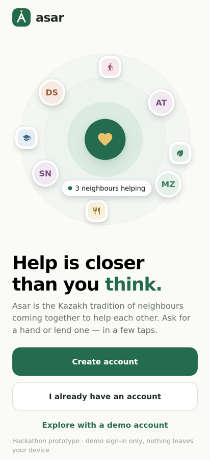
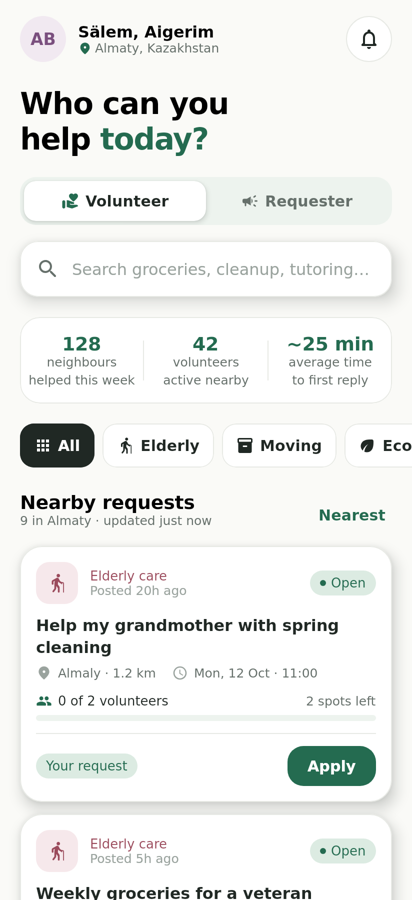
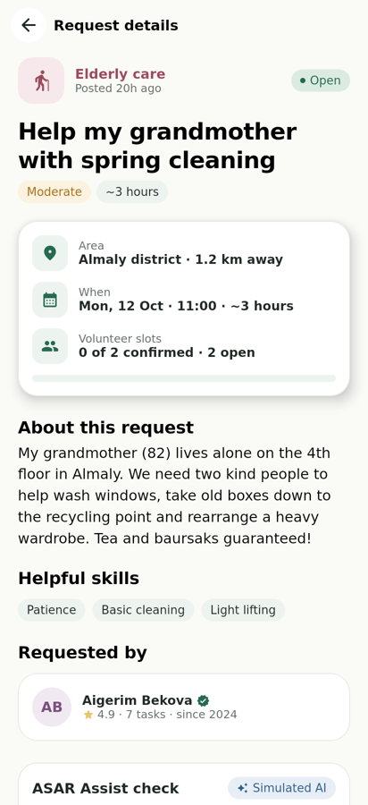
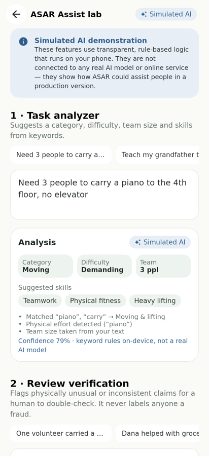
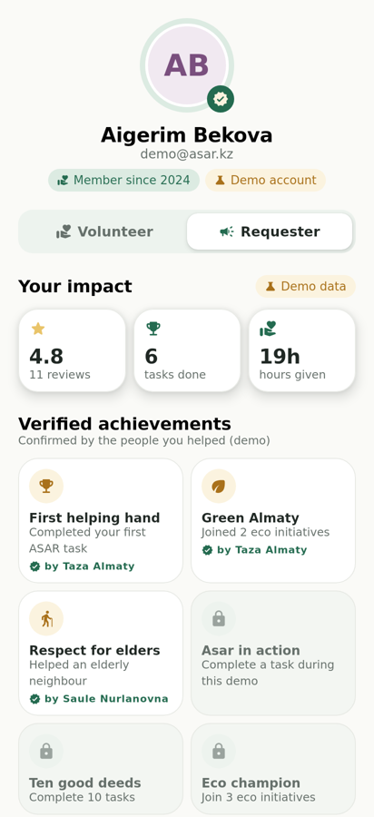

# ASAR — volunteer marketplace

**Asar** is the Kazakh tradition of neighbours coming together to help each other. This
hackathon prototype brings that tradition to Android: people **request help**, neighbours
**volunteer**, and anyone can switch between the two roles in one tap.

<p>
  
  
  
  
  
</p>

> **Prototype notice.** No backend, no database and no network. All data is realistic mock
> data held in memory and resets when the app is closed. Sign-in is **demo authentication
> only** and is not secure. The "AI" features are **simulated**: transparent rule-based
> logic running on the device, not a real AI model.

## Tech

- Kotlin, Jetpack Compose, Material 3 (Compose BOM 2024.12.01)
- AGP 8.7.3, Kotlin 2.0.21, Gradle 8.14.3 wrapper, `compileSdk 35`, `minSdk 26`
- Package `com.asar.app`
- Dependencies: AndroidX core, activity-compose, lifecycle (ViewModel), Compose UI, Material 3
  and extended icons. Nothing else.

## Run

Open the project in Android Studio (Ladybug or newer) and run the `app` configuration, or:

```bash
./gradlew :app:assembleDebug          # app/build/outputs/apk/debug/app-debug.apk
./gradlew :app:installDebug           # install on a connected device/emulator
```

## Web version

`web/index.html` is the ASAR website: the same screens, demo flow and simulated AI, in Kazakh,
Russian and English (switcher in the header; it defaults to the browser language and remembers
the choice). On phones it uses the bottom tab bar, on desktop a top navigation.

It runs in two modes:

- **Demo mode** (default, `web/config.js` left empty): no server; data lives in the browser tab and
  the email code is shown on screen. Open the file in any browser.
- **Connected mode**: a real Supabase (Postgres) database with accounts, requests, applications and
  reviews, and **two-step sign-in**: password, then a 6-digit code sent by email. The database
  enforces both steps through row-level security. Setup takes about 15 minutes:
  see [`web/SETUP.md`](web/SETUP.md). Schema and demo content are in `web/supabase/`.

## Demo script (≈2 minutes)

1. **Welcome** → *Explore with a demo account* (or *Create account* with any name/email/6+ char password).
2. **Create** tab → tap the *Groceries for grandma* quick start → *ASAR Assist* suggests
   category, difficulty, team size and skills → *Use suggestions* → *Publish request*.
   The request appears at the top of **Home** immediately.
3. On Home switch to **Volunteer** → open your new request → *Apply to help* → *Send application*.
4. Switch back to **Requester** (Home, Profile or the details screen) → **My Tasks** →
   *Accept* the application.
5. Open the request → *Mark as completed* → rate the volunteer. Tap *Try an unusual claim*
   to see the piano example flagged **for additional verification** (never labelled fraud).
6. **Profile** shows the new review, updated rating/completed count and an unlocked achievement.

Bonus: *Profile → ASAR Assist lab* is a playground for both simulated-AI features.

The seeded request *"Help my grandmother with spring cleaning"* already has two applicants,
so accept/decline can also be shown instantly.

## Project structure

```
app/src/main/java/com/asar/app/
├── MainActivity.kt              edge-to-edge host
├── ai/                          simulated AI (rule-based, on-device)
│   ├── TaskAnalyzer.kt          category / difficulty / team size / skills
│   └── ReviewVerifier.kt        plausibility check for reviews and claims
├── data/
│   ├── model/Models.kt          tasks, applications, reviews, achievements…
│   ├── MockData.kt              Almaty-based demo content
│   ├── TaskRepository.kt        in-memory store (Compose snapshot state)
│   └── DemoAuth.kt              demo-only sign up / sign in
└── ui/
    ├── AsarViewModel.kt         single source of truth + all demo actions
    ├── theme/                   colors, type, shapes, spacing, theme
    ├── components/              buttons, cards, pills, task card, role switcher…
    ├── navigation/              app shell, bottom bar, overlay navigation
    └── screens/                 welcome, home, details, create, mytasks, profile, ai
```
